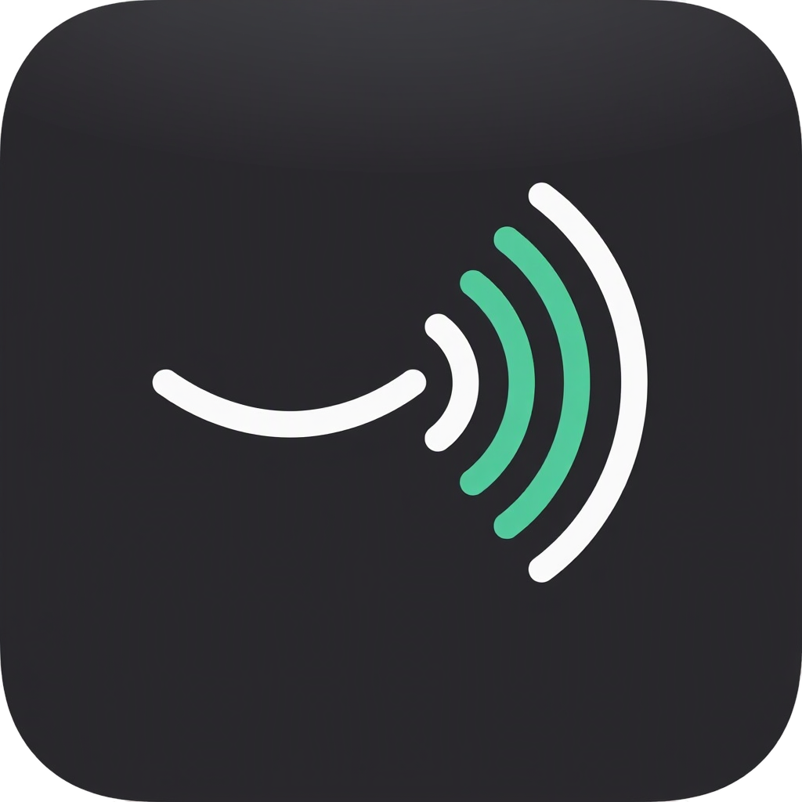

<p align="center">
  
</p>

# Zero Eyes

Reads your AI coding agent's answers aloud on macOS, so you can look away from the screen and still follow the work.

```
┌───────────────────────────────────────────────────────────────┐
│  ⏮   ⏯   ⏹   ⏭   🔇   −   +20%   +   ⌃   ✕                  │
│  Claude · The build passed and the PR is open, waiting on CI… │
│  Answer 12 of 40 · 2 queued                                   │
└───────────────────────────────────────────────────────────────┘
```

- **Speaks the answer, not your screen.** Each finished answer is read once, from the text the agent actually produced.
- **One shared queue.** Claude Code, OpenCode and any text you select can all speak through the same player; the newest three wait, the rest are dropped so nothing goes stale.
- **A floating bar you can actually use.** Pause, stop, step through recent answers, change speed, or mute everything while the queue keeps draining silently.
- **Knows which app is talking.** The first line names the app the speech came from: `Claude`, `T3 Code`, `OpenCode`, `Google Chrome`, and so on.
- **Select text and press a key.** A macOS Service reads the selection in any app.
- **Reply by voice.** Press the reply shortcut, speak, and your words are transcribed on this Mac and pasted into the app in front.

## Requirements

- macOS 13 or later
- `python3`
- Optional: a Premium or Enhanced English voice, which sounds much better than the
  built-in compact ones. Add one in System Settings › Accessibility › Spoken Content ›
  System Voice › Manage Voices; the player picks the best installed one on its own.
- Optional: [`edge-tts`](https://github.com/rany2/edge-tts) for Microsoft Edge's Read
  Aloud voices (`ENGINE="edge"`): `python3 -m pip install --user edge-tts`. The installer
  pins whichever `python3` can import it into the player's shebang, because hooks run
  with a minimal PATH where the wrong interpreter would be found.
- Xcode command line tools are optional. With `swiftc` the installer builds the overlay;
  without it, the installer downloads the prebuilt overlay from the latest GitHub release.
- [`whisper-cpp`](https://github.com/ggml-org/whisper.cpp) is optional, for voice replies:
  `brew install whisper-cpp`. The speech model (`ggml-base.en`, about 148 MB) is downloaded
  on first use.

By default the Mac's own voices speak, offline. Set `ENGINE="apple" | "edge" | "say"`
in the config to choose.

## Install

With Homebrew:

```sh
brew install pawantekchandani/tap/zero-eyes
zero-eyes-setup
```

Run `zero-eyes-setup` again after each `brew upgrade zero-eyes`.

Or from a clone:

```sh
git clone https://github.com/pawantekchandani/zero-eyes.git
cd zero-eyes
scripts/install.sh
```

That installs the player to `~/.local/bin/zero-eyes`, builds (or downloads) and starts the overlay, adds the login agent, wires the Claude Code Stop hook, links the OpenCode plugin, and copies the three macOS Services.

Install one piece at a time with `scripts/install.sh --only player|overlay|launchagent|claude-code|opencode|services`.

See what is installed and what is missing with `scripts/install.sh --check` (or `zero-eyes-setup --check`). It changes nothing, prints the fix for each missing item, and also runs at the end of a full install.

Then assign shortcuts in **System Settings › Keyboard › Keyboard Shortcuts › Services**: `Zero Eyes Read` (suggested ⌃⌥Z), `Zero Eyes Stop` (suggested ⌃⌥X) and `Zero Eyes Reply` (suggested ⌃⌥R).

Test it:

```sh
printf '%s' "Zero Eyes is installed." | ~/.local/bin/zero-eyes
```

## Use

The overlay appears with the first thing spoken and can be dragged anywhere; it remembers its place and whether it was collapsed.

| Button | Action |
| --- | --- |
| ⏮ / ⏭ | previous / next answer in the shared history |
| ⏯ | pause, resume; when idle, replay the last answer |
| ⏹ | stop and clear the queue |
| 🔇 | mute all output — the queue keeps draining, nothing piles up |
| − / + | speech rate in 10% steps; applies from the next part of the answer now playing |
| 🎤 | reply by voice: press to start, press again to send |
| ⌃ / ⌄ | collapse to a small pill |
| Send to Dock | minimize the overlay to the Dock; click the Dock icon to bring it back |
| ✕ | quit the overlay |

Buttons redraw at once on click; the player catches up in the background.

From the terminal:

```sh
printf '%s' "text" | zero-eyes   # queue it
zero-eyes --now                  # state as one JSON line
zero-eyes --stop | --pause | --mute | --next | --previous | --replay
zero-eyes --rate-up | --rate-down
zero-eyes --reply                # start a voice reply; run again to send
```

## Reply by voice

1. Press `Zero Eyes Reply` (or the 🎤 button). Speech stops and a sound plays.
2. Speak. Press again, or stop talking for 2 seconds, to finish.
3. `whisper-cli` transcribes the recording on this Mac. The audio file is deleted.
4. The text is pasted into the app in front. With `REPLY_SUBMIT="true"`, Return is pressed too.

The overlay asks for two permissions for **Zero Eyes Overlay**: Microphone (to record)
and Accessibility (to paste). Without Accessibility the text stays on the clipboard and
the overlay says "Reply copied. Press Command V." The overlay is ad-hoc signed, so after
a rebuild macOS may ask again.

## Features

- **Tables are read aloud.** Each row is spoken as `Header: value, Header: value.`, between "Table." and "End of table.", instead of being skipped.
- **Fast start.** An answer is fetched in parts: a short first part, then parts of about 250 characters. Sound starts after the first part, and later parts are fetched while earlier ones play.
- **Instant Previous and Replay.** Fetched parts are cached in the state folder (the newest 60 answers), so a replayed answer starts at once.
- **Live speed change.** Each part is fetched at the rate set at that moment, so − / + changes the answer that is playing, not only the next one.
- **No gap between answers.** While one answer plays, the first part of the next waiting answer is fetched, so the next answer starts about 0.05 s after the last one ends.
- **Responsive overlay.** Play, Pause, Stop, Next and Previous show their new state as soon as they are clicked.
- **Dock.** The overlay has a Dock icon and a Send to Dock button, so it can be hidden and brought back.

## How the queue behaves

One worker plays items in order, one at a time. Only the newest three may wait; a fourth arrival drops the oldest waiting item. Whatever is already speaking is never cut off. That keeps a fast agent from building a backlog you hear ten minutes later, while still letting two quick answers from different sessions both get heard.

## Integrations

| Harness | How | Where |
| --- | --- | --- |
| Claude Code (CLI, desktop, T3) | Stop hook speaks `last_assistant_message` | `integrations/claude-code/` |
| OpenCode | Plugin speaks finished answers; `/zero-eyes`, `/zero-eyes-stop` | `integrations/opencode/` |
| Any app, selected text | macOS Services: `Zero Eyes Read`, `Zero Eyes Stop` | `integrations/macos-service/` |
| Anything else | `printf '%s' "$text" \| zero-eyes` | `integrations/generic/example.sh` |

Per-session rules (speak only certain roles, mute a session) are configuration, not code: see [docs/apps.md](docs/apps.md).

## Configuration

`~/.config/zero-eyes/config`:

| Key | Default | Meaning |
| --- | --- | --- |
| `ENGINE` | `apple` | `apple` = the Mac's own voices, offline (`auto` means the same); `edge` = Edge voices only; `say` = `say` speaks directly |
| `APPLE_VOICE` | empty | Apple voice name or identifier; empty = the best installed English voice (Premium, then Enhanced, then the system voice) |
| `VOICE` | `en-IN-PrabhatNeural` | Edge voice; `edge-tts --list-voices` shows all |
| `RATE` | `+0%` | speaking rate, for every engine |
| `VOLUME` | `+0%` | Edge volume |
| `PITCH` | `+0Hz` | Edge pitch |
| `MUTED` | `false` | muted at start |
| `AUTO_READ` | `true` | whether OpenCode auto-read starts on |
| `REPLY_MODEL` | empty | whisper model file; empty = `ggml-base.en`, downloaded on first use |
| `REPLY_LANGUAGE` | `en` | language passed to whisper |
| `REPLY_SUBMIT` | `false` | press Return after pasting a reply |
| `REPLY_SILENCE` | `2` | seconds of silence that end a reply; `0` = only the shortcut ends it |

Details, state files and overrides: [docs/configuration.md](docs/configuration.md).

## Notes

- By default speech uses the Mac's own voices and stays on your machine.
- `ENGINE="edge"` uses Microsoft Edge's own Read Aloud voice endpoint through the unofficial [`edge-tts`](https://github.com/rany2/edge-tts) package. No key, no account, no quota — and no guarantee: it is undocumented and Microsoft can change or block it at any time. Using that endpoint is your call and your responsibility.
- Nothing leaves your machine except, with `ENGINE="edge"`, the text sent to that voice endpoint. Voice replies are transcribed locally. No telemetry, no accounts.
- State is per-user, in `~/Library/Application Support/Zero Eyes` (mode 700): the queue, the last 50 answers, and the current item. Delete that folder to clear history.
- Not affiliated with ZeroEyes Inc. or any other company of a similar name — this is an independent listening tool for your own machine, not a security or surveillance product.
- The overlay is ad-hoc signed and built locally; it is not notarized, and it is started by path rather than through LaunchServices for that reason.

## Uninstall

```sh
scripts/uninstall.sh           # remove the install, keep config and history
scripts/uninstall.sh --purge   # also remove config, state and backups
```

## License

MIT — see [LICENSE](LICENSE).
